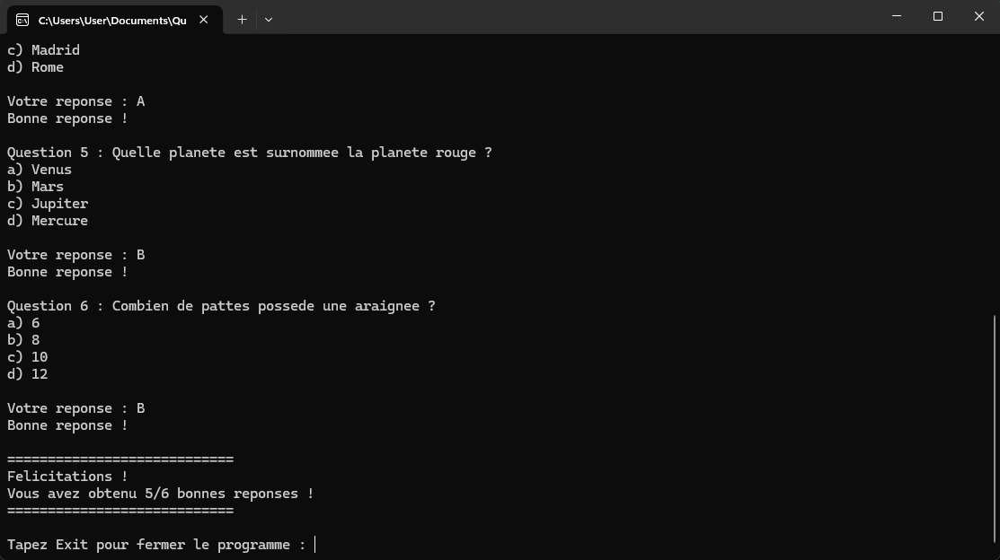

# Jeu Quiz

## Présentation

Jeu de quiz développé en langage C.

Le joueur doit répondre à une série de questions à choix multiples. Chaque partie propose 6 questions sélectionnées aléatoirement parmi 16 questions.

## Fonctionnalités

- Sélection aléatoire de 6 questions différentes parmi 16.
- 4 réponses possibles pour chaque question.
- Vérification automatique des réponses.
- Prise en charge des réponses en majuscules et en minuscules.
- Calcul et affichage du score final.
- Répétition de la saisie en cas de réponse invalide.

## Technologies utilisées

- Langage C
- GCC (compilateur)
- Visual Studio Code / terminal Windows

## Installation et lancement

1. Télécharger le fichier `main.c`.
2. Installer GCC si nécessaire.
3. Ouvrir un terminal dans le dossier contenant `main.c`.
4. Compiler le programme avec la commande :

```bash
gcc main.c -o quiz.exe
```

5. Lancer le jeu avec :

```bash
.\quiz.exe
```

## Captures d'écran

### Accueil et question


### Résultat final


## Vidéo de démonstration

[Regarder la vidéo de démonstration](Demonstration-Quiz-Game.mov)

## Auteur

Alex Théraulaz

Projet personnel de programmation en langage C.
